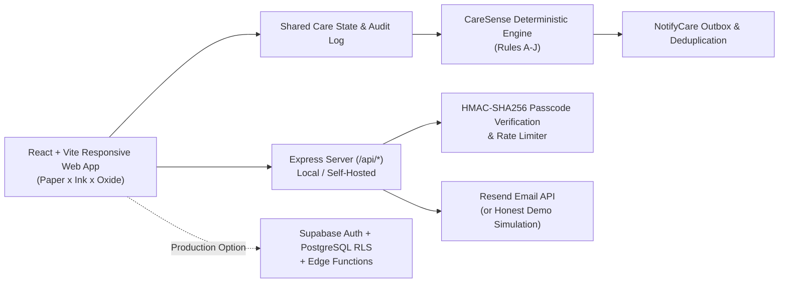

# ElderShield 2.0

> **Your health. Your family. One connected circle of care.**

ElderShield is an interconnected elderly care, medication management, appointment coordination, and family collaboration web platform designed to keep elderly individuals at the center of their healthcare decisions while keeping authorized family members and caretakers informed.

---

## 1. Official Challenge Vertical

**Elderly Care & Medication Management Platform**

## 2. Official Problem Statement

Develop a smart, interconnected healthcare management platform designed to help elderly individuals manage their daily medications, medical appointments, and healthcare routines while keeping their family members and caretakers informed. The platform provides a shared ecosystem where elderly individuals, caretakers, and family members access and manage an elderly person's healthcare profile through secure, passcode-based access, with proactive email reminders for upcoming doses, unconfirmed medications, and medical appointments.

## 3. Problem Analysis

1. **Fragmented routines**: Elderly individuals often track pills on paper, appointments on wall calendars, and family updates over scattered text messages.
2. **Unsafe assumptions**: Basic reminder apps mark a missed tap as "missed dose" or encourage catching up—both can cause dangerous confusion. ElderShield uses **"not yet confirmed"** language and never advises doubling doses.
3. **Unbounded access risks**: Sharing one universal family PIN exposes sensitive information without accountability or revocation.
4. **Notification fatigue**: Broadcasting every routine update to every relative leads to alert burnout; permissions and quiet hours must filter who receives what.

## 4. Target Users & Personas

| Role | Persona (Demo) | Primary Responsibilities & Authority |
| :--- | :--- | :--- |
| **Elderly Profile Owner** | Arthur Pendelton | Central owner of profile, permissions, consent matrix, invitations, and daily dose confirmations. |
| **Family Member** | Claire Pendelton | Authorized family coordinator managing schedules, appointments, care notes, and follow-up alerts. |
| **Caretaker** | Samuel Okafor | Daytime home caregiver confirming doses, logging shift handovers, and acknowledging care alerts. |

## 5. Proposed Solution & Core Modules

ElderShield connects six modules over one shared state model:

1. **MediTrack**: Medication CRUD, daily schedule, 7-day matrix, duplicate-protected confirmations, and field-level schedule audit log.
2. **AppointmentHub**: Doctor visit management, 14-day calendar overview, preparation & follow-up notes, and automatic cancellation of obsolete reminders upon rescheduling.
3. **CareSense**: Deterministic, explainable JavaScript decision engine covering 10 contextual care scenarios (`A` through `J`).
4. **FamilyConnect**: Caregiver shift handovers (preserving history), granular permission scopes, server-hashed passcode invitations, and shared activity timeline.
5. **NotifyCare**: Privacy-safe email reminders, deduplication keys, quiet-hour enforcement, Resend server integration, and honest demo simulation.
6. **HealthVault**: Data-minimized personal profile, emergency information card, and per-member category consent controls.

### Feature-to-Problem-Statement Mapping

| Problem Statement Requirement | ElderShield Implementation | Verification Status |
| :--- | :--- | :--- |
| Elderly individuals manage daily medications | `Senior Simple View` + `MediTrack` | Implemented & tested |
| Family & caretakers stay informed | `FamilyConnect` + Shared Timeline + `CareSense` | Implemented & tested |
| Secure, passcode-based shared access | Express `/api/invitations/*` HMAC-SHA256 + Supabase Edge Function `redeem-invitation` | Server logic implemented & tested; Supabase requires env credentials |
| Add, edit & manage medication schedules | `MediTrack` CRUD + `medicationChangeLogs` | Implemented & tested |
| Track medication adherence | 7-day rolling confirmed/unconfirmed/skipped calculation | Implemented & tested |
| Monitor upcoming doctor appointments | `AppointmentHub` timeline + 14-day calendar | Implemented & tested |
| Coordinate healthcare routines | Shift handover notes + acknowledgement workflow | Implemented & tested |
| Proactive email reminders | `NotifyCare` + Resend server integration + Supabase `process-notifications` | Simulated locally unless `RESEND_API_KEY` is configured |

---

## 6. System Architecture Diagram



## 7. Database Architecture

Production SQL migrations live in `supabase/migrations/`:
- `001_initial_schema.sql`: Defines `profiles`, `memberships`, `invitations`, `medications`, `medication_events`, `medication_change_logs`, `appointments`, `caregiver_notes`, `care_tasks`, `notification_preferences`, `notification_outbox`, `audit_events`, and `emergency_contacts`.
- `002_rls_policies.sql`: Enables Row Level Security (`RLS`) on all tables with helper functions `is_active_member(profile_id)` and `has_profile_permission(profile_id, perm)`.

## 8. Passcode-Based Access Flow

```mermaid
sequenceDiagram
    participant Owner as Elderly Profile Owner
    participant Server as Express / Edge Function
    participant Guest as Invited Member
    Owner->>Server: POST /api/invitations/create (role, permissions, expiry)
    Server->>Server: Generate ES-XXXX-XXXX + random salt -> HMAC-SHA256 hash
    Server-->>Owner: Return one-time passcode (plaintext never stored)
    Owner-->>Guest: Share passcode out-of-band
    Guest->>Server: POST /api/invitations/redeem (passcode, name, email)
    Server->>Server: Rate-limit + timingSafeEqual(hash) + check expiry/attempts
    Server-->>Guest: Grant server-assigned role & permissions; mark code redeemed
```

## 9. Permission Model

Permissions are scoped per member rather than granting blanket access:
- `view_profile`, `manage_medications`, `record_medication_status`, `view_appointments`, `manage_appointments`, `add_care_notes`, `manage_members`, `manage_notifications`, `acknowledge_alerts`.
- Only the **Elderly Profile Owner** can generate passcodes, edit member permission scopes, modify HealthVault category consent, or revoke member access.

## 10. CareSense Decision Engine (`src/engine/caresense.ts`)

Every generated decision explains **1. What happened**, **2. Why detected**, **3. Relevant records**, **4. Who should be informed (with reasons)**, and **5. Appropriate action**:
- **A**: Upcoming medication (45m pre-dose window)
- **B**: Due medication (within confirmation window; never assumes missed)
- **C**: Overdue / not yet confirmed past reminder window
- **D**: Medication marked taken (recalculates 7-day adherence & pending alerts)
- **E**: Medication marked skipped (flags review + warns never to double doses)
- **F**: Repeated unconfirmed/skipped entries (>= 2 in 7 days)
- **G**: Upcoming appointment within reminder lead hours
- **H**: Rescheduled appointment (cancels obsolete queued reminders)
- **I**: Caregiver handover note (preserves prior notes)
- **J**: Notification preference, permission & quiet-hours filter audit

## 11. Email Notification Architecture

- **Privacy-safe subjects**: Email subject lines and previews never expose medication names or medical advice.
- **Deduplication**: Deterministic `deduplicationKey` prevents duplicate emails per event/day/recipient.
- **Quiet hours**: Overnight quiet windows (e.g., `22:00–07:00`) suppress non-urgent alerts.
- **Honest status distinction**:
  - When `RESEND_API_KEY` is configured on the server, `POST /api/notifications/process` dispatches via Resend (`status: sent_live`).
  - When unconfigured, items enter `status: simulated_sent` with an explicit banner stating **no external email was sent**.

## 12. Medication & Appointment Workflows

- **MediTrack**: Prevents duplicate completion events for the same `(medicationId, dateKey, scheduledTime)`. All schedule edits log `previousValue`, `newValue`, author, and timestamp.
- **AppointmentHub**: Supports `upcoming`, `rescheduled`, `completed`, and `cancelled` statuses, preparation/follow-up notes, and a 14-day calendar overview.

## 13. Privacy, Security & Accessibility

- **Security**: No secret keys in frontend (`VITE_*` never holds service role or email keys), input sanitization, timing-safe passcode comparison, rate-limiting, single-use expiring passcodes, and explicit disclosure that `localStorage` is for demonstration persistence only.
- **Accessibility**: Minimum `18px` body text, `22px+` medication titles, `48px` minimum touch targets, `Atkinson Hyperlegible` + `Bricolage Grotesque` + `IBM Plex Mono` typography with system fallbacks, keyboard focus rings, `prefers-reduced-motion` support, non-color-only status indicators, and a dedicated **Senior Simple View**.
- **Responsive Design**: Adapts smoothly across narrow mobile browsers (`375px+` with fixed bottom thumb-zone tabs), tablets, laptops, and wide desktops (`1440px+`) without horizontal overflow.

## 14. Technology Stack

- **Frontend**: React 19, TypeScript, Vite 8, Tailwind CSS v4, Lucide Icons, Motion
- **Server (Local/Self-Hosted)**: Express 4, Node.js `crypto`, `tsx`
- **Production Backend Blueprint**: Supabase (Auth, PostgreSQL + RLS, Deno Edge Functions) + Resend Email API
- **Testing**: Node.js built-in test runner (`node:test` + `tsx --test`)

## 15. Installation, Environment Variables & Running Locally

```bash
npm install
cp .env.example .env
npm run dev
```

Open `http://localhost:3000`.

### Environment Variables (`.env.example`)
- `PORT` (default `3000`)
- `VITE_SUPABASE_URL` / `VITE_SUPABASE_ANON_KEY` (optional, for Supabase production mode)
- `SUPABASE_SERVICE_ROLE_KEY` (server/Edge Function only)
- `RESEND_API_KEY` & `RESEND_FROM_EMAIL` (server-only, enables real email delivery)
- `INVITATION_HMAC_SECRET` (server-only HMAC key for passcode hashing)

### Deployment Instructions
1. **Frontend + Express Full-Stack**: Run `npm run build` then `npm start` (`node server.ts`).
2. **Supabase + Resend Production**:
   - Apply `supabase/migrations/001_initial_schema.sql` and `002_rls_policies.sql`.
   - Deploy `supabase/functions/redeem-invitation` and `supabase/functions/process-notifications`.
   - Set `RESEND_API_KEY`, `RESEND_FROM_EMAIL`, and `INVITATION_HMAC_SECRET` in Supabase secrets.

## 16. Test Methodology & Actual Test Results

Run all automated tests with:
```bash
npm test
```

Latest verified test suite covers:
- `tests/unit/caresense.test.ts`: All CareSense scenarios (`A`–`J`), adherence stats, and context clock shifts.
- `tests/unit/notifications-permissions.test.ts`: Privacy-safe email copy, deduplication keys, overnight quiet hours, and permission revocation.
- `tests/integration/server-security.test.ts`: Salted HMAC-SHA256 passcode verification, single-use enforcement, expiry, and revocation rejection.

## 17. Implementation Honesty Matrix

| Capability | Status |
| :--- | :--- |
| MediTrack, AppointmentHub, CareSense (`A`–`J`), FamilyConnect, HealthVault, Senior Simple View, Demo Lab | **Implemented & Tested** |
| Express Passcode Hashing, Rate Limiting, & Resend Integration Endpoint | **Implemented & Tested** (runs on `/api/*`) |
| Supabase PostgreSQL Migrations, RLS Policies & Deno Edge Functions | **Implemented in `supabase/`, not externally provisioned** (requires project credentials) |
| External Email Delivery & Scheduled Background Cron | **Simulated in Local Demo Mode** unless `RESEND_API_KEY` + Supabase cron are configured |

## 18. Assumptions & Known Limitations

- Local Demonstration Mode stores fictional care data in browser `localStorage` and server memory for instant evaluation; it is **not** a HIPAA-certified medical record system.
- Emergency Information Card displays user-entered contacts only and does **not** perform automatic emergency dispatch.
- Real-world clinical deployment requires legal compliance review (HIPAA/GDPR), persistent managed database provisioning, and external email domain verification.

## 19. Demo Instructions

1. Launch the app and try **Switch to Senior Simple View** for the large-print elderly experience.
2. Open **Demo Lab** in the header to trigger any scenario (e.g., *Overdue / Not Yet Confirmed*, *Repeated Unconfirmed Entries*, or *Rescheduled Appointment*).
3. Inspect **CareSense** to verify how all 5 explanation fields update dynamically.
4. Open **Family → Passcode Invitations & Join** and redeem the sample single-use passcode `ES-DEMO-4829` (or generate a new passcode as the Profile Owner).
5. Open **NotifyCare** to preview privacy-safe reminders and run a simulated (or Resend-live) outbox batch.
